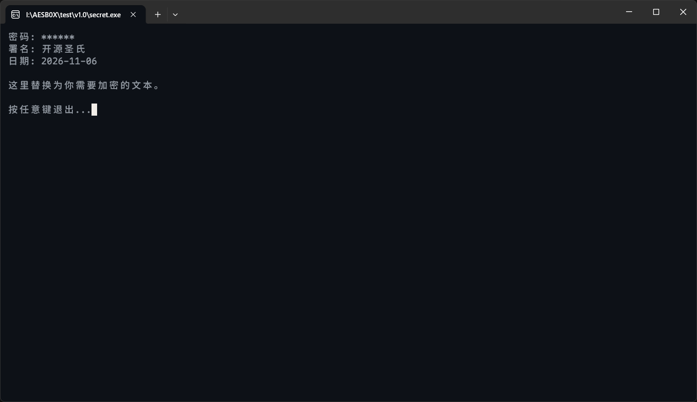

# AESB0X

> 基于 AES-256-CTR 算法的轻量化文本加密、解密工具，提供 CLI 界面。

## 项目简介

**AESB0X** 是一个面向个人使用场景的轻量级文本加密工具。项目采用 AES-256-CTR 作为加密算法，密码经 SHA-256 派生为密钥，全部代码以纯 C 语言编写，可使用 TCC 或 GCC 直接编译（本仓库提供的版本为TCC编译），无任何第三方运行时依赖。

项目提供 `v1.0` 与 `v2.0` 两个版本，分别面向“单文件分发”与“批量处理”两类使用场景。



## 版本说明

### v1.0 — 单文件自解密

适用于将一段文本加密后，以单个可执行文件的形式发送给他人。

- `mksecret.exe` 读取同目录下的 `input.txt`，提示输入署名与密码；
- 运行后生成 `secret.exe`，密文与解密逻辑封装于同一个文件中；
- 接收方双击 `secret.exe`，输入正确密码后，原文在终端中显示；
- 输出内容包含生成时记录的署名与日期。

### v2.0 — 批量加密、单选解密

适用于对多个文本文件进行统一加密与管理。

- `encode.exe` 自动扫描当前目录下所有 `*.txt` 文件，一次输入署名与密码，逐个加密为同名 `*.bin` 文件；
- `decode.exe` 自动扫描当前目录下所有 `*.bin` 文件，列出清单供用户选择其中一个，输入密码后显示该文件的原文；
- 每个文件使用独立的随机 IV，相同内容加密后得到的密文互不相同。

## 快速开始

### 编译

项目源码使用 TCC 或 GCC 编译：

```bash
# v1.0
tcc mksecret.c -o mksecret.exe

# v2.0
tcc encode.c -o encode.exe
tcc decode.c -o decode.exe
```

使用 GCC 时，将 `tcc` 替换为 `gcc` 即可。

### 使用

**v1.0：**

1. 将待加密文本写入 `input.txt`，与 `mksecret.exe`、`aes_sha.h` 置于同一目录；
2. 双击 `mksecret.exe`，依次输入署名与密码；
3. 生成 `secret.exe`，可单独发送给接收方；
4. 接收方双击 `secret.exe` 并输入密码，即可查看原文。

**v2.0：**

1. 将所有待加密的 `*.txt` 文件与 `encode.exe`、`aes_sha.h` 置于同一目录；
2. 双击 `encode.exe`，输入署名与密码，生成同名 `*.bin` 文件；
3. 将 `decode.exe` 与 `*.bin` 文件一并发送给接收方；
4. 接收方双击 `decode.exe`，从列表中选择目标文件并输入密码，即可查看原文。

> 建议通过独立渠道（如口头告知、另一条消息）传递密码，避免与密文文件通过同一渠道发送。

## 技术细节

| 项目 | 说明 |
|------|------|
| 加密算法 | AES-256-CTR |
| 密钥派生 | SHA-256(密码) |
| 随机数 | 每个文件使用独立随机 IV |
| 密码校验 | 明文前缀包含固定标识，解密后比对 |
| 字符编码 | 输入文件自动识别 UTF-8 / ANSI，统一转为 UTF-8 处理；控制台输出切换至 UTF-8 代码页 |
| 编译环境 | TCC / GCC，纯 C 语言，无外部依赖 |

## 安全性说明

本项目定位为**轻量级混淆与访问控制工具**，适用于“防止文件在传输或存放过程中被无意查看”的场景，**不适用于对抗具备逆向能力的攻击者**。

使用者应了解以下边界：

1. **密码强度决定安全性上限。** 密钥派生使用 SHA-256，未采用内存硬型 KDF（如 Argon2id、scrypt）。若密码较弱，攻击者可在获取密文后进行离线暴力破解。建议使用长度不少于 12 位、包含大小写字母、数字与符号的随机密码。
2. **本地解密无法防御内存分析。** 程序在运行期间会将明文还原至内存，具备调试能力的攻击者可通过调试器或内存转储工具直接读取。这是所有本地解密方案的共同限制。
3. **不提供密文完整性保护。** AES-CTR 模式本身不防篡改，程序通过明文前缀校验密码正确性，但不能完全防止密文被有针对性修改。
4. **密码一经遗失，密文无法恢复。** 项目不包含任何密码找回、后门或密钥托管机制。

## 开源协议与使用须知

本项目依据 [GPLv3](LICENSE) 许可证开源发布。开发者对使用者所加密的任何内容均不知情，且不具备解密能力。因使用本项目所产生的一切后果，均由使用者自行承担。

特此声明。
